## Задача 1. Включение аппаратной виртуализации (Intel VT-x / AMD-V)
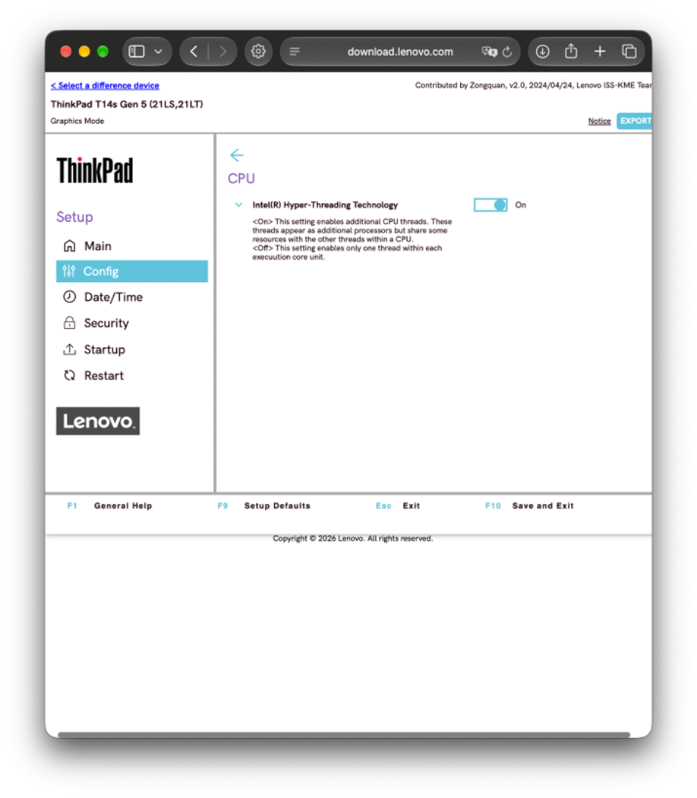
Config → CPU. Опция Intel Virtualization Technology
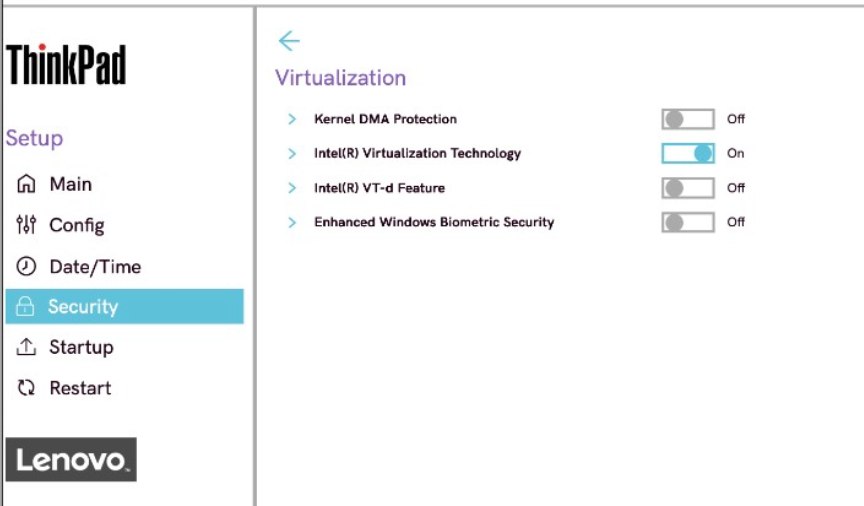
Security → Virtualization
## Задача 2. Проверка статуса TPM и его связь с BitLocker
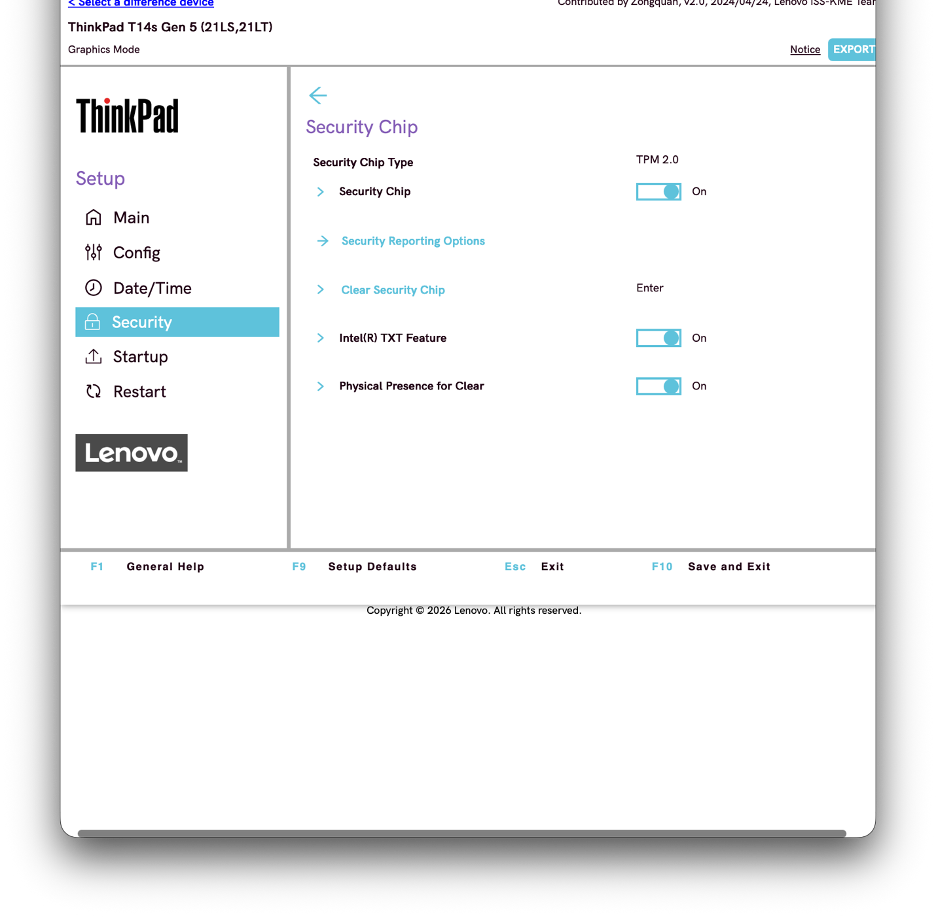
Security → Security Chip

## Задача 3. Настройка поведения при потере питания (After Power Loss)

По умолчанию стоит Off.

## Задача 4. Отключение Secure Boot и проверка последствий
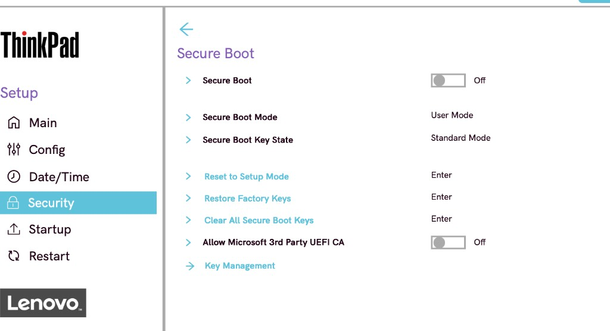
Security → Secure Boot. Secure Boot (Off)
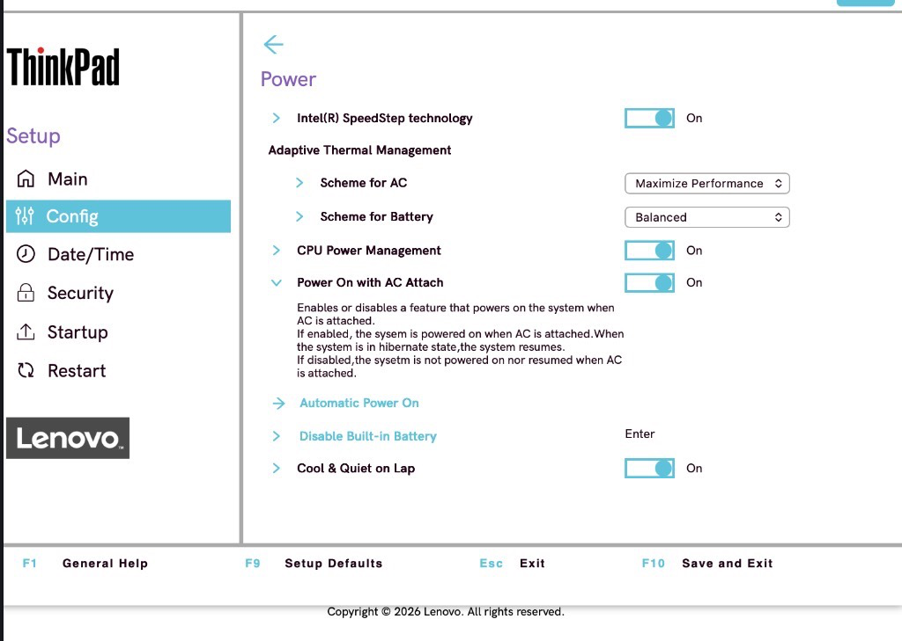
Security → Secure Boot. Secure Boot (On)

## Задача 5. Настройка порядка загрузки через Fast Boot
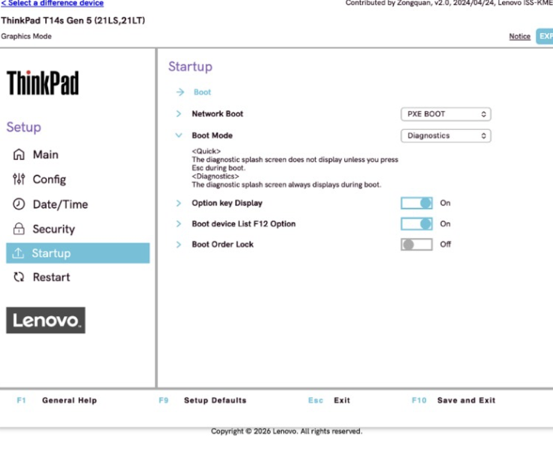
Когда включен Fast Boot (Quick), компьютер пытается быстрее запустить систему, из-за этого он не проверяет USB-порты, поэтому не видит флешку.

## Задача 6. Установка пароля на включение (Power-On Password)
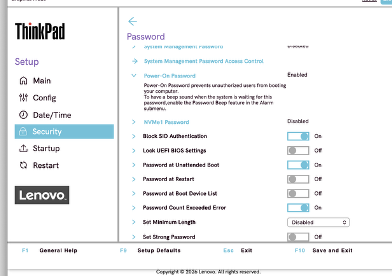

## Задача 7. Настройка SATA Controller Mode для установки ОС
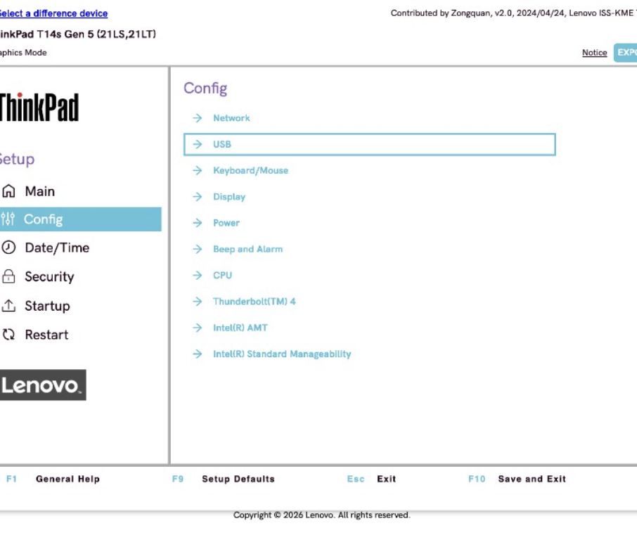

## Задача 8. Просмотр и очистка системного журнала событий (Event Log)
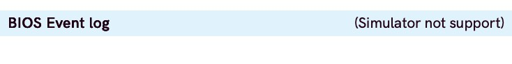
В журнале BIOS обычно фиксируются ошибки при запуске компьютера (POST), замене деталей или настроек, при попытке ввести неверный пароль.

## Задача 9. Восстановление заводских настроек с сохранением пользовательских данных
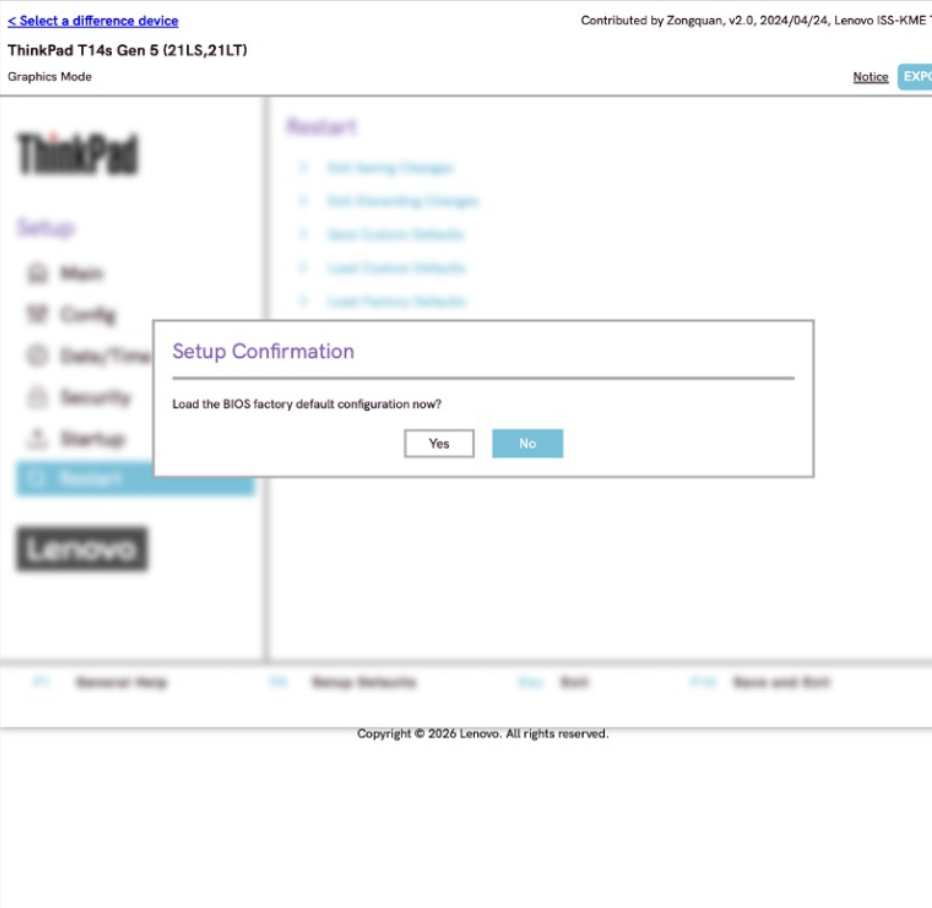
Restart → Load Factory Defaults
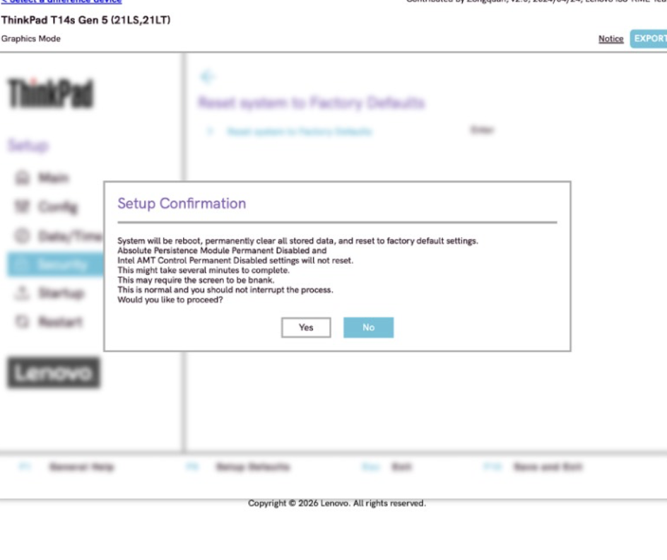
Security → Reset System to Factory Defaults
## Задача 10. Полный сценарий: подготовка нового сотрудника (IT-администратор)
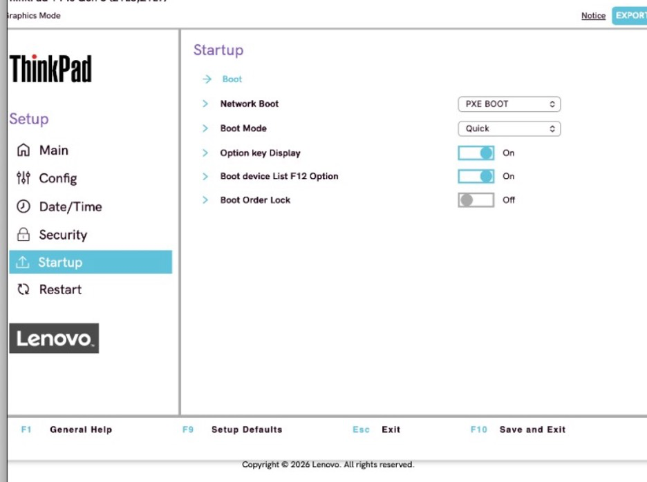
