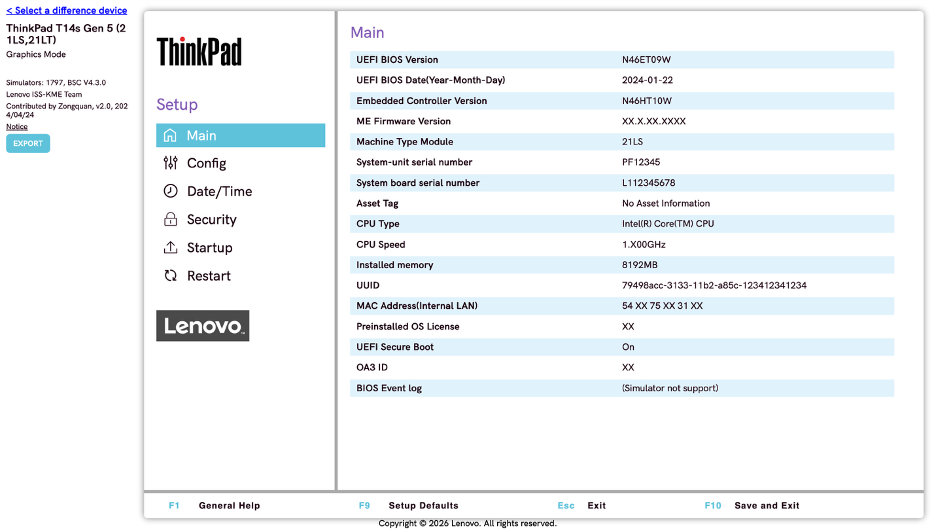
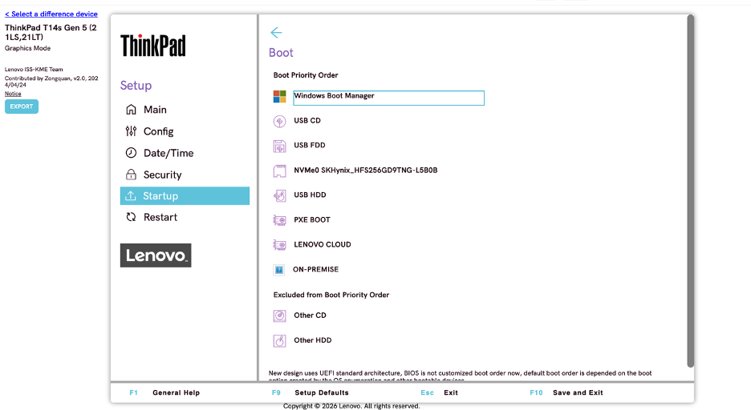
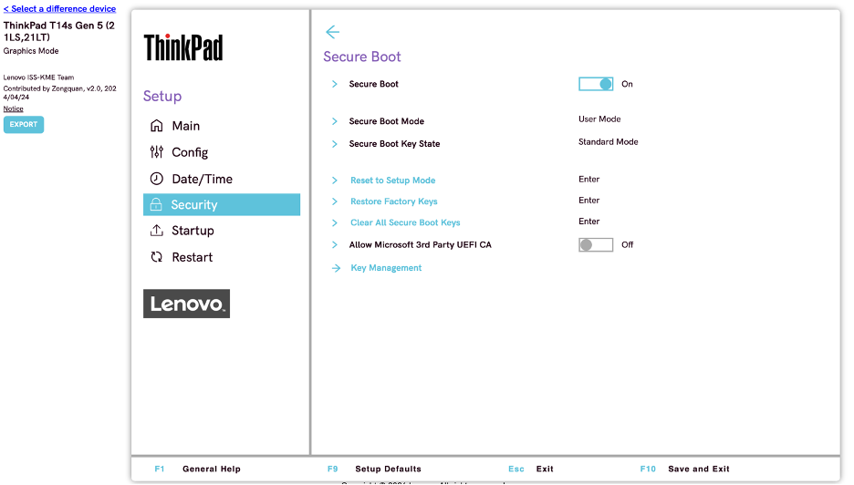
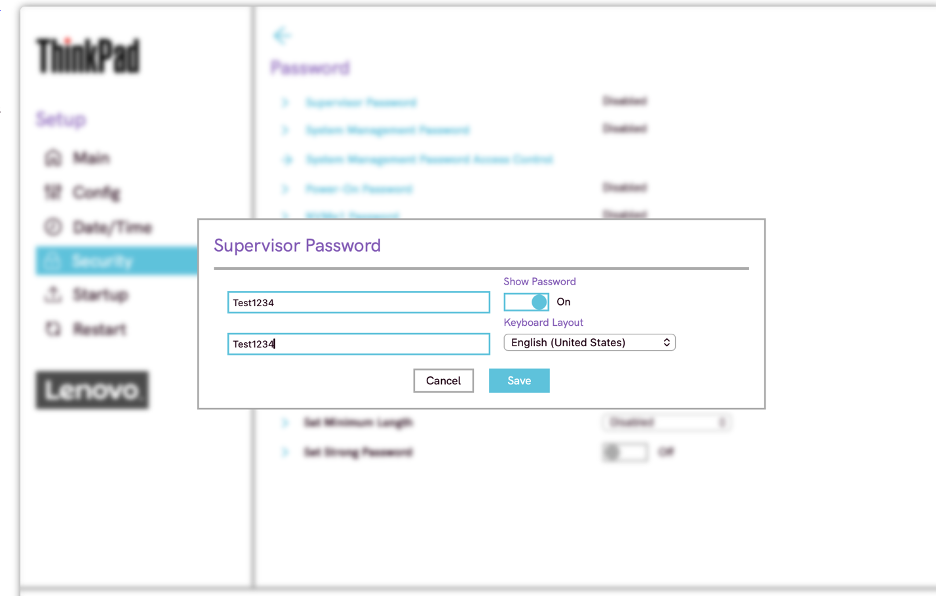
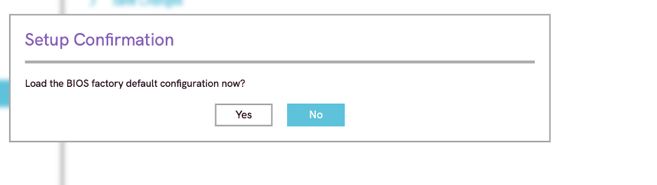
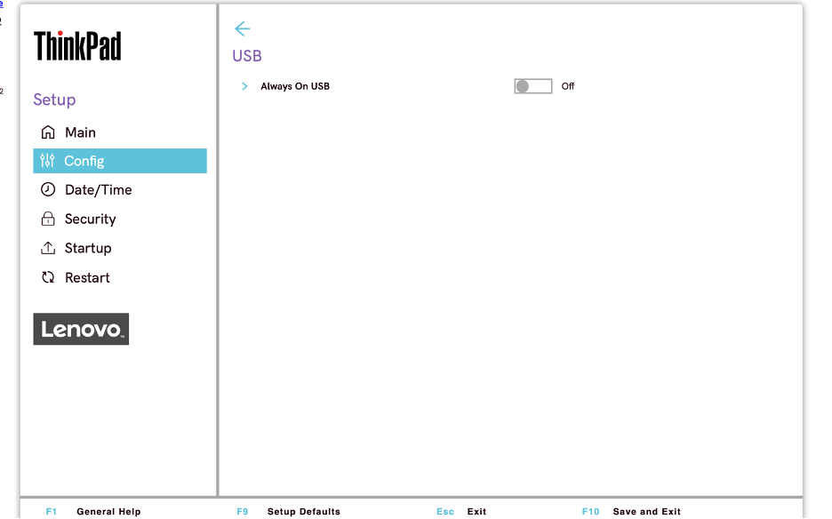
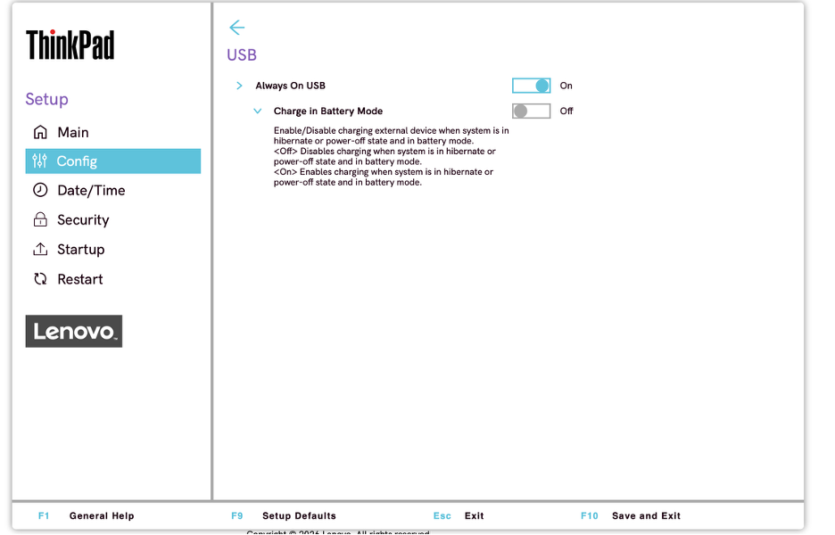
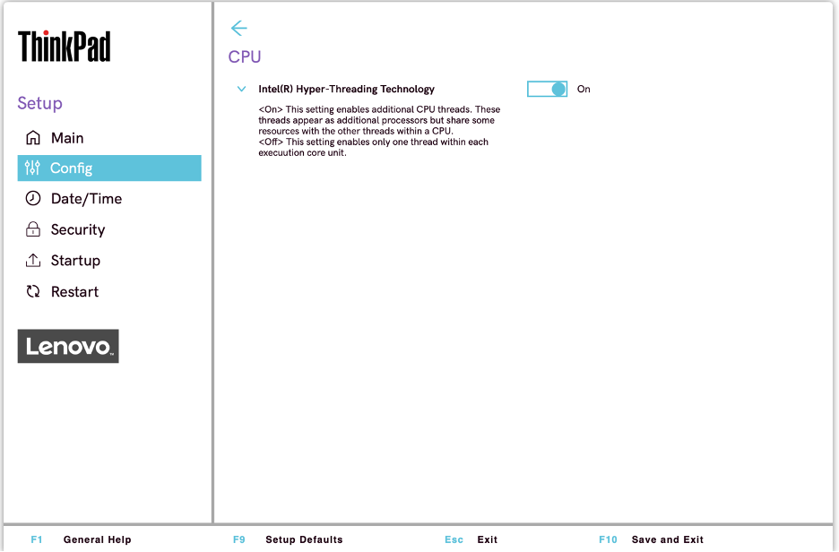
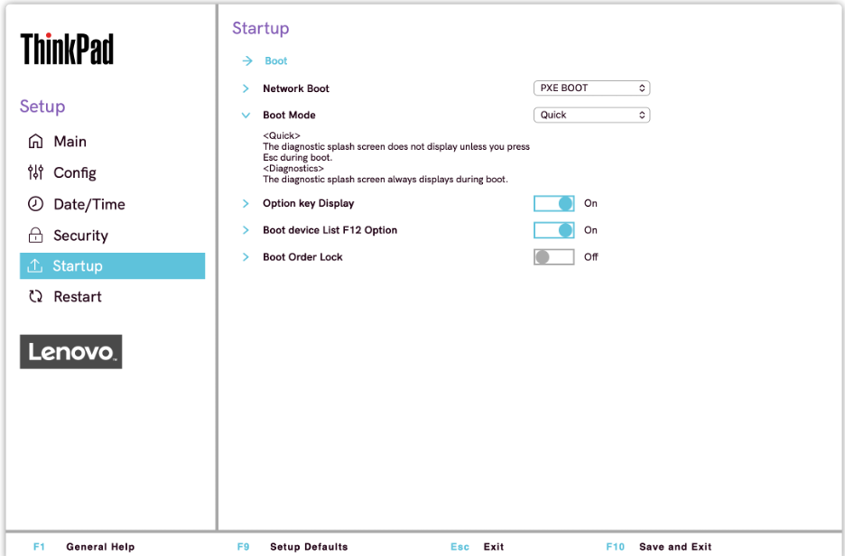
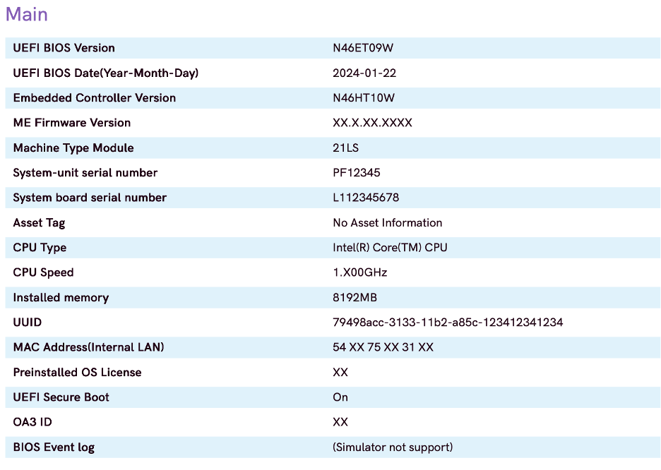

# Практика №2
## Задача 1. Навигация по основным разделам
**Цель:** Запомнить структуру меню UEFI.
**Задание:** Последовательно откройте разделы Main, Config, Security, Startup, Restart. Выпишите, какая информация отображается в Main (серийный номер, версия UEFI, тип CPU).
**Критерий готовности:** Вы можете без подсказки назвать, в каком разделе находится каждая из настроек из задач 2–5.

## Задача 2. Смена порядка загрузки

**Цель:**   Научиться менять приоритет загрузочных устройств.
**Задание:**  Перейдите в Startup → Boot. Сделайте USB первым, NVMe — вторым. Запомните клавишу сохранения (F10).
**Критерий готовности:**  Порядок изменён, вы знаете, где он отображается после повторного входа

## Задача 3. Включение/выключение Secure Boot

**Цель:** Понять назначение Secure Boot.
**Задание:** Перейдите в Security → Secure Boot. Проверьте статус, переключите на противоположный, верните обратно. Отметьте, требуется ли перезагрузка.
**Критерий готовности:** Вы можете объяснить, зачем нужен Secure Boot и где он включается.

## Задача 4. Установка пароля супервизора

**Цель:** Отработать установку пароля администратора UEFI.
**Задание:** Перейдите в Security → Password → Supervisor Password. Установите пароль Test1234. Попробуйте изменить любую настройку — должен появиться запрос пароля. Затем сбросьте пароль.
**Критерий готовности:** Пароль установлен, проверен и снят.

## Задача 5. Сброс на заводские настройки

**Цель:** Научиться возвращать UEFI к исходному состоянию.
**Задание:** Перейдите в Restart → Load Factory Defaults (или F9). Подтвердите сброс. Проверьте, что настройки из задач 2–4 сброшены.
**Критерий готовности:** Настройки вернулись к исходным, вы знаете комбинацию для сброса.

## Задача 6. Управление встроенными устройствами

**Цель:** Отработать управление периферией на низком уровне.
**Задание:** Перейдите в Config → USB. Найдите USB BIOS Support или Always On USB. Отключите, затем включите обратно. Запишите точный путь.
**Критерий готовности:** Вы знаете, где отключается USB-поддержка в UEFI.

## Задача 7. Режим работы SATA/NVMe

**Цель:** Понять разницу между режимами контроллера.
**Задание:** Перейдите в Config → Storage → SATA Controller Mode (или NVMe Mode). Посмотрите варианты (AHCI / RAID / Intel RST), переключите и верните обратно. Обратите внимание на предупреждения.
**Критерий готовности:** Вы можете назвать доступные режимы и риски их смены.

## Задача 8. Временное меню загрузки (эмуляция F12)

**Цель:** Научиться использовать Boot Menu без изменения постоянных настроек.
**Задание:** Найдите опцию Startup → Boot Mode или эмуляцию F12 Boot Menu. Активируйте, затем вернитесь в главное меню.
**Критерий готовности:** Вы понимаете разницу между постоянным порядком загрузки и временным выбором устройства.

## Задача 9. Просмотр системных логов

**Цель:** Научиться диагностировать проблемы через UEFI.
**Задание:** Перейдите в Main → System Summary (или Config → Diagnostics). Найдите раздел с логами POST/событий. Просмотрите их, найдите Clear Event Log (если есть) и очистите.
**Критерий готовности:** Вы знаете, где искать логи и как их очистить.

## Задача 10. Полный сценарий: подготовка к переустановке ОС

**Цель:** Закрепить все навыки в одном практическом задании.
**Задание (последовательно):**
1. Сбросить настройки на Factory Defaults (1 мин).
2. Включить Secure Boot (1 мин).
3. Установить Supervisor Password (2 мин).
4. Поставить USB первым в порядке загрузки (2 мин).
5. Сохранить и выйти (F10) (1 мин).
6. Снова войти, проверить настройки, сбросить пароль и вернуть порядок загрузки (2 мин).
